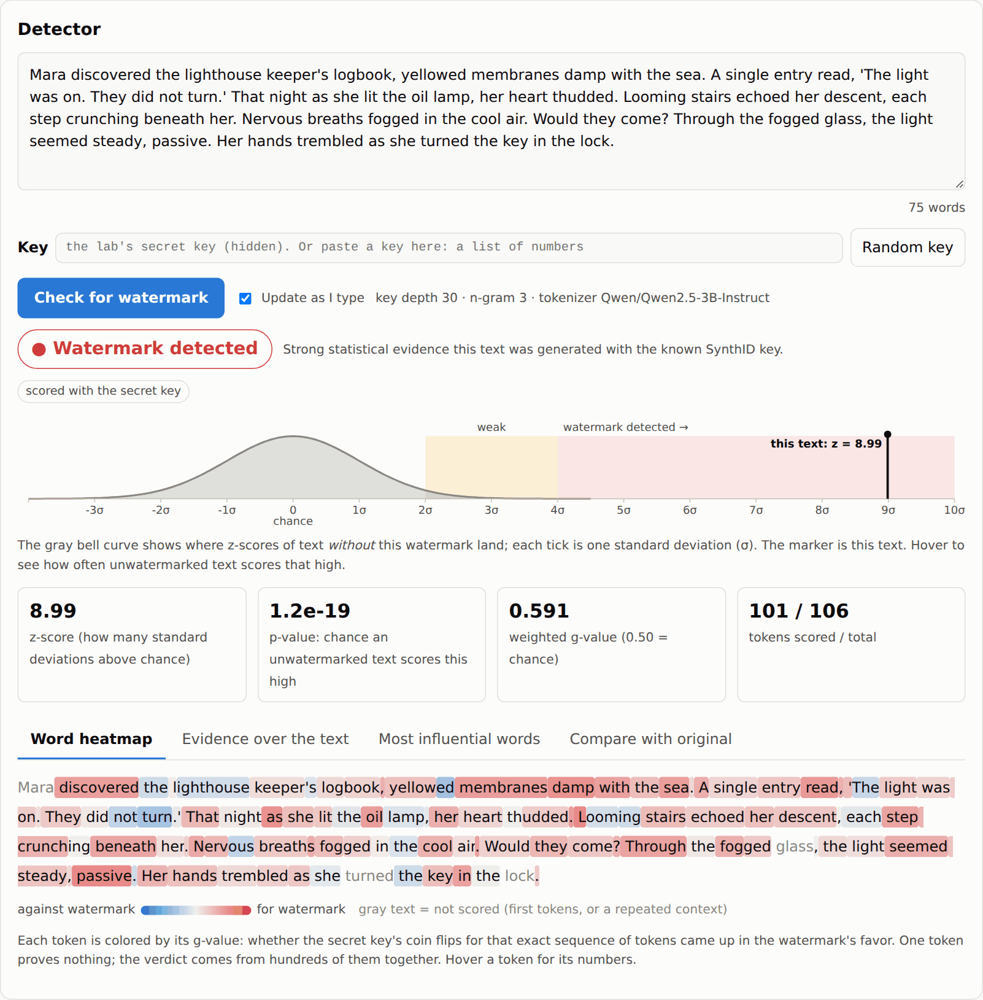
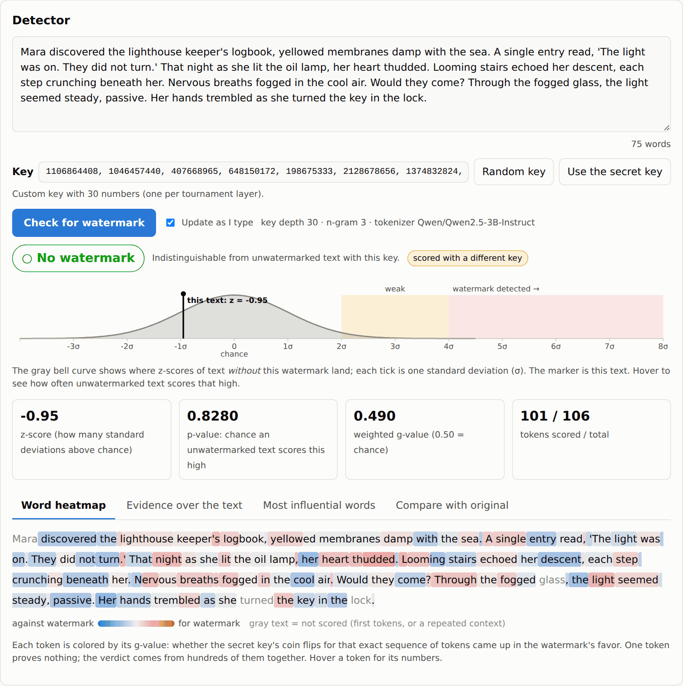
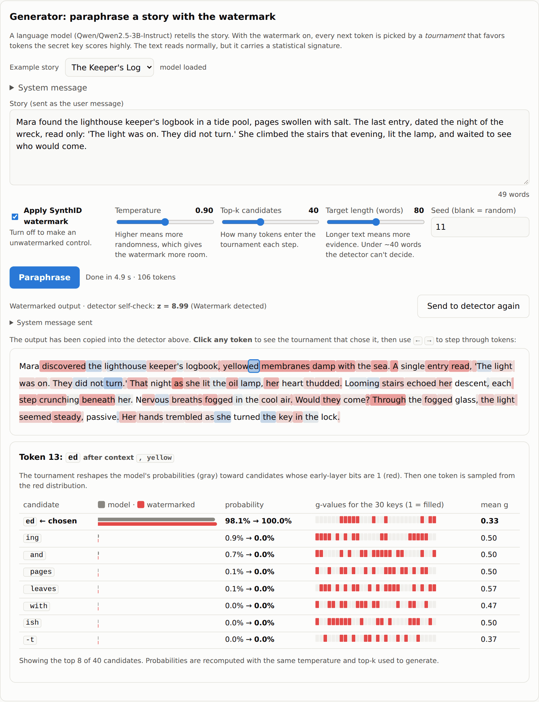
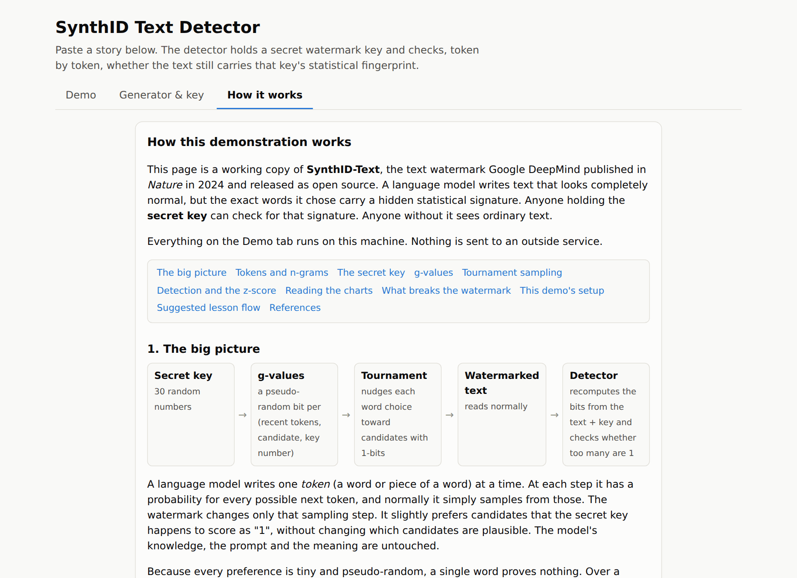

# How SynthID works: a live SynthID-Text watermark detector and classroom lab

**A self-hosted, open-source lab for exploring Google DeepMind's SynthID-Text watermark for
AI-generated text.** It pairs a watermarked LLM paraphraser with a real-time detector so you can
watch, token by token, how the watermark is written into text and how quickly it fades as the text is
edited. Built on the production SynthID-Text implementation in Hugging Face `transformers`.

## What this repository explores

SynthID is Google DeepMind's family of watermarking tools for AI-generated content. SynthID-Text, the
text variant, was published in *Nature* in 2024 and released as open source [1, 2]. It is the
watermark Google applies to text produced by Gemini [3]. Unlike "AI detectors" that try to guess
whether prose sounds machine-written, SynthID-Text is a **key-based** scheme: a secret key nudges the
language model's word choices at generation time, and only someone holding the same key can later
test for that nudge [1]. The text reads normally and the model's knowledge, prompt and meaning are
untouched; the signal lives entirely in *which exact tokens* were sampled.

That design raises the question this repository is built around: **how tightly is the watermark tied
to the content of the text?** SynthID-Text scores each token from a hash of the few tokens before it
(an n-gram) and the key [1]. So the watermark is a property of exact token sequences, not of meaning
or style. Copy the output verbatim and the detector is certain. Swap a handful of words and the
evidence weakens. Rewrite the passage in your own words and the watermark is gone, even though the
story is the same, because almost none of the original n-grams survive. This is the known
limitation of all n-gram and sampling-based text watermarks, and of statistical AI-text detection in
general, against paraphrasing [4, 5, 6, 7], and it is exactly what the lab lets participants
experience for themselves.

To make that concrete, the repository provides a **live tool** that shows text identification
changing in real time:

* A **detector page** that re-scores whatever you type as you type it, placing the z-score on the
  bell curve of what unwatermarked text scores, and coloring every token by whether its key-derived
  "coin flip" favored the watermark. You can watch the verdict move from "watermark detected" to
  "weak" to "no watermark" as you edit a passage, and see which tokens still carry the signal.
* A **wrong-key test** that scores the same text with a random key, showing that the detector finds
  the *key*, not "AI-ness".
* A **generator view** that paraphrases short stories with or without the watermark and exposes the
  tournament sampling step for every token: the model's own probabilities, how the key reweighted
  them, and the g-value bits per key layer [1].
* An **explainer tab** that walks participants from tokens and n-grams through tournament sampling to
  the z-score, with a suggested lesson flow.

Everything runs on your own hardware with keys you control. The generator needs a GPU (it was built
on an NVIDIA DGX Spark); the detector needs only the tokenizer and the keys, so it runs anywhere,
including a laptop. No training is involved: the detector is the paper's "weighted mean" g-value
test [1], implemented with `SynthIDTextWatermarkingConfig` and
`SynthIDTextWatermarkLogitsProcessor` from `transformers` [2, 8].

**Who this is for:** instructors running a hands-on activity on AI-text watermarking, students
asking "how does SynthID work?", and anyone evaluating how robust generative-AI watermarks are to
editing and paraphrasing.

## What the dashboard shows

The page opens on the **Detector**. Paste any text and it is scored as you type against the lab's
secret key. You get a verdict, the z-score placed on the bell curve of what unwatermarked text scores,
a p-value, and a per-token heatmap: red tokens are n-grams whose key-derived coin flips came up in the
watermark's favor, blue ones went against it. Other tabs show the evidence accumulating across the
text, the most influential words, and an n-gram comparison with the original story.



The **Key** box is the wrong-key test. Click "Random key" and the very same text drops back to
chance, which is the point: this is a *key* detector, not an "AI detector".



"Show the generator & key" opens the **Generator** (instructor side). Pick or write a ~50-word story,
set temperature, top-k, target length and seed, and paraphrase it with or without the watermark. The
output goes straight into the detector. Click any output token to see the tournament that chose it:
the model's own probabilities, how the watermark reweighted them, and the g-value bits per key layer.



The **How it works** tab is a self-contained explainer for participants, from tokens and n-grams
through the tournament to the z-score, with a suggested lesson flow and references.



## Run it locally

Detector only (no GPU, a few hundred MB for the tokenizer):

```bash
python3 -m venv .venv && source .venv/bin/activate     # Windows: .venv\Scripts\activate
pip install torch --index-url https://download.pytorch.org/whl/cpu
pip install -r requirements.txt
python scripts/make_keys.py                            # writes data/keys.json (keep it private)
SYNTHID_MODE=detect uvicorn synthid_lab.server:app --port 8000
```

Open <http://localhost:8000>. The detector and the "How it works" page work immediately; the
generator is disabled in this mode. To check the whole pipeline on a CPU, `python scripts/smoke_test.py`
generates and detects with a 360M model in about a minute.

Detector **and** generator (a GPU with ~6 GB free for the default Qwen2.5-3B-Instruct; the model is
downloaded from Hugging Face on first use):

```bash
pip install torch            # or the CUDA wheel for your platform; on a DGX Spark see below
SYNTHID_PRELOAD=1 uvicorn synthid_lab.server:app --host 0.0.0.0 --port 8000
```

Set `SYNTHID_ADMIN_TOKEN=<secret>` to require an `X-Admin-Token` header on `/api/generate` so
participants cannot generate fresh watermarked text during the session. The detector and the generator
must share one `data/keys.json` and one `SYNTHID_NGRAM_LEN`; copy the keys file to any machine that
runs a detector.

Screenshots in `docs/screenshots/` were taken from a live instance; regenerate them with Playwright
against a running server if the UI changes.

## How SynthID-Text works in one paragraph

SynthID-Text changes *which token the model samples* at each step [1]. For every position it hashes the
previous `ngram_len - 1` tokens together with each secret key to produce a set of pseudo-random bits
("g-values"), then runs a tournament that prefers candidate tokens whose g-values are 1. Unwatermarked
text has g-values that are fair coins (mean 0.5). Watermarked text has a mean noticeably above 0.5. The
detector re-derives the g-values from the pasted tokens and the keys and reports how far above 0.5 the
mean is as a z-score, weighting early tournament layers (which carry most of the signal) 10x more than
the last [1]. z >= 4 means p < 0.00003 under the "no watermark" hypothesis.

Consequence for the activity: the watermark lives in exact token n-grams. Pasting the LLM output
verbatim lights the detector up. Swapping a few words weakens it. Rewriting the story in your own words
destroys it, because almost none of the original n-grams survive. That is the point worth teaching,
so plan the activity as a gradient (see "Running the activity").

## Layout

```
synthid_lab/config.py      model id, ngram_len, sampling settings (env-overridable); loads data/keys.json
synthid_lab/watermark.py   Generator (needs the LLM) and Detector (tokenizer + keys only)
synthid_lab/server.py      FastAPI: GET /  POST /api/detect  POST /api/generate  GET /api/info
static/index.html          dashboard: detector (heatmap, z-curve, top words, compare) + "show the generator & key"
scripts/make_keys.py       create the secret key set (data/keys.json, git-ignored)
scripts/make_paraphrases.py batch-generate watermarked + control paraphrases for every story
scripts/calibrate.py       check the null distribution / threshold
scripts/show_prompt.py     print the exact prompt the model receives (no weights loaded)
scripts/smoke_test.py      end-to-end check with a 360M model on CPU
data/prompt.txt            system prompt template for the paraphraser ({words}, {how} placeholders)
data/stories.json          your ~50-word stories (3 placeholders included; shown as examples in the dashboard)
deploy/synthid-lab.service user systemd unit (port 8090, preloads the model)
docs/screenshots/          dashboard screenshots used in this README
Dockerfile                 DGX Spark image based on the NGC PyTorch container
```

## Setup on the DGX Spark (current deployment)

This Spark also runs a vLLM server on port 8000 that holds most of the unified memory, so the lab runs
Qwen2.5-3B-Instruct (~6 GB) in-process next to it, on port **8090**, as a user systemd service:

```bash
uv venv .venv -p 3.12
uv pip install -p .venv torch --index-url https://download.pytorch.org/whl/cu130
uv pip install -p .venv -r requirements.txt
.venv/bin/python scripts/make_keys.py
cp deploy/synthid-lab.service ~/.config/systemd/user/
systemctl --user daemon-reload && systemctl --user enable --now synthid-lab
loginctl enable-linger $USER            # start at boot without a login session
journalctl --user -u synthid-lab -f     # logs
```

Open `http://<spark-ip>:8090`. The page opens on the detector only. It re-scores as you type (toggle
"Update as I type"), and its Key box scores against any key you paste or a random one, which is the
wrong-key test; empty means the lab's secret key. Tabs show a word heatmap, the z-score building up
across the text, the most influential words, and a comparison with the original story.

"Show the generator & key" reveals the paraphraser (watermark toggle, temperature / top-k / length /
seed), a per-token tournament view (click a token, then use the arrow keys), and the secret key. Each
paraphrase is copied into the detector automatically.

A hosted OpenAI-compatible endpoint can't be used for the watermarked text: the watermark is applied
inside sampling, which the endpoint does itself.

## Setup on the DGX Spark (Docker, standalone)

The Spark is aarch64 + Blackwell (sm_121) with CUDA 13, so use NVIDIA's container rather than a
PyPI torch wheel. Do **not** `pip install torch` inside it; that replaces NVIDIA's build with a CPU one.

```bash
git clone <this repo> synthid-lab && cd synthid-lab
python3 scripts/make_keys.py                       # writes data/keys.json  (keep private!)
docker build -t synthid-lab .
docker run --gpus all -p 8000:8000 \
  -v $PWD/data:/app/data \
  -v $HOME/.cache/huggingface:/root/.cache/huggingface \
  -e SYNTHID_MODEL=Qwen/Qwen2.5-7B-Instruct \
  -e SYNTHID_ADMIN_TOKEN=change-me \
  synthid-lab
```

Then open `http://<spark-ip>:8000`. The detector works immediately; the model downloads and loads on
the first paraphrase request (about 15 GB for the 7B model, a minute or two to load).

Alternative without Docker (uv, cu130 aarch64 wheels):

```bash
uv venv .venv && source .venv/bin/activate
uv pip install torch --index-url https://download.pytorch.org/whl/cu130
uv pip install -r requirements.txt
python scripts/make_keys.py
SYNTHID_ADMIN_TOKEN=change-me uvicorn synthid_lab.server:app --host 0.0.0.0 --port 8000
```

Model choice (the default is Qwen2.5-3B-Instruct; the 7B needs ~15 GB free): anything with a chat template works. `Qwen/Qwen2.5-7B-Instruct` is ungated and a good
paraphraser. `google/gemma-3-12b-it` is thematically nice (SynthID is Google's) but gated: accept the
license on Hugging Face and set `HF_TOKEN`. The Spark's 128 GB fits either in bf16 with room to spare.

### Batch-generate the materials

```bash
# inside the container or venv, on the Spark
python scripts/make_paraphrases.py --n 3 --controls 1
python scripts/calibrate.py
```

`make_paraphrases.py` writes `data/paraphrases.json` with, per story: the human original, three
watermarked paraphrases, and one unwatermarked control, each with its detector score. Print the
watermarked ones for participants. `calibrate.py` prints z-score summaries per kind; originals and
controls should hover around 0, watermarked rows should be well above 4.

## Local development (Windows / laptop)

```powershell
python -m venv .venv
.venv\Scripts\python -m pip install torch --index-url https://download.pytorch.org/whl/cpu
.venv\Scripts\python -m pip install -r requirements.txt
.venv\Scripts\python scripts\make_keys.py
.venv\Scripts\python scripts\smoke_test.py          # ~1 min on CPU, downloads SmolLM2-360M
```

Run the detector page locally against the same keys and tokenizer (no GPU needed):

```powershell
$env:SYNTHID_MODE="detect"; .venv\Scripts\python -m uvicorn synthid_lab.server:app --port 8000
```

## Knobs that matter

| Setting | Where | Effect |
|---|---|---|
| `SYNTHID_NGRAM_LEN` | env / `config.py` | Context length hashed per token. 5 is Google's default and is fragile to edits. 3 survives more editing and is better for a classroom gradient. Generator and detector must match. |
| keys (`data/keys.json`) | `make_keys.py` | Length = watermark depth (30 by default, as in the paper). More layers = stronger signal per token. |
| `SYNTHID_TEMPERATURE` | env | Higher = more entropy = stronger watermark. 0.9 to 1.0 works well. |
| paraphrase length | length slider / `{words}` in `data/prompt.txt` | Detection power grows with sqrt(tokens). 150 words gives z of about 13 to 17; 50 words about 4 to 6; under ~30 words is usually inconclusive. |
| thresholds | `verdict_for()` | z >= 4 "watermarked", 2 to 4 "weak", else "no watermark". |
| system prompt | `data/prompt.txt` (or `SYNTHID_PROMPT_PATH`), editable per request in the dashboard | Template for the paraphrase instructions. `{words}` becomes the target length and `{how}` an expand / condense phrase. `python scripts/show_prompt.py --words 50` prints exactly what the model receives. |
| `SYNTHID_TARGET_WORDS` | env / dashboard slider | Length the paraphrase prompt asks for (default 50, adjustable 10 to 150 in the dashboard). Small models write about as many words as the input unless asked to expand. |

Note on devices: transformers seeds the g-value sampling table with `torch.Generator(device)`, and the
CUDA and CPU generators give different tables for the same seed, so text watermarked on a GPU was
undetectable by a CPU detector. `make_processor()` now always seeds on the CPU and moves the table, and
the generator passes that processor to `generate()`, so a laptop detector matches a GPU generator.

## Running the activity

Suggested flow, which turns the inevitable "no watermark" on a full rewrite into the lesson:

1. **Verbatim.** Participants paste the watermarked paraphrase as given. Detector: strong (z of 8 to 15 for 150 to 200 words).
2. **Light edit.** Change five to ten words. Detector: usually still "watermarked" or "weak". Ask them to find which tokens kept the heat.
3. **Heavy edit.** Reorder sentences, replace half the words. Detector: "weak" or gone.
4. **Own words.** Rewrite from memory. Detector: "no watermark". Discuss why (the watermark is in token n-grams, not in meaning), and what that implies about watermarks as a defense against determined paraphrasing versus casual copy-paste [5, 6].
5. **Control.** Paste an unwatermarked LLM paraphrase and the human original: both read as "no watermark", which shows the detector is not an "AI detector" but a *key* detector.

Operational notes:

* The detector endpoint is cheap (tokenize + hash); dozens of simultaneous participants are fine on the Spark or even a laptop.
* Keep `data/keys.json` off participant machines. Anyone with the keys can forge the watermark.
* `SYNTHID_ADMIN_TOKEN` gates `/api/generate` so participants cannot generate fresh watermarked text during the session.

## Frequently asked questions

**Is this an AI detector?** No. It detects one specific SynthID key. Text from any model, including
Gemini, reads as "no watermark" here unless it was generated with *this lab's* key. Google's own
SynthID detector works the same way with Google's keys [1, 3].

**Does SynthID-Text change what the model says?** Only which of several plausible next tokens gets
sampled, and only when the model is uncertain. Where one token has nearly all the probability the
watermark has nothing to work with, which is why low-entropy text (code, lists, factual boilerplate)
carries a weaker signal [1].

**Can a watermark survive paraphrasing?** Partially at best. Light edits usually leave enough intact
n-grams to detect; a full rewrite does not [1, 4, 5]. Shorter n-gram context (`SYNTHID_NGRAM_LEN=3`
here instead of Google's default 5) trades some secrecy for more edit tolerance [1].

**How long does the text need to be?** Detection power grows with the square root of the number of
scored tokens. Around 50 words gives a z-score of 4 to 6; 150 words gives 13 to 17; under about 30
words is usually inconclusive [1].

## References

1. S. Dathathri, A. See, S. Ghaisas, P.-S. Huang, R. McAdam, J. Welbl, V. Bachani, A. Kaskasoli,
   R. Stanforth, T. Matejovicova, J. Hayes, N. Vyas, M. A. Merey, J. Brown-Cohen, R. Bunel,
   B. Balle, T. Cemgil, Z. Ahmed, K. Stacpoole, I. Shumailov, C. Baetu, S. Gowal, D. Hassabis and
   P. Kohli. "Scalable watermarking for identifying large language model outputs." *Nature* 634,
   818–823 (2024). <https://doi.org/10.1038/s41586-024-08025-4>
2. Google DeepMind. *SynthID-Text* reference implementation.
   <https://github.com/google-deepmind/synthid-text>
3. Google DeepMind. *SynthID: identifying AI-generated content.*
   <https://deepmind.google/technologies/synthid/>
4. J. Kirchenbauer, J. Geiping, Y. Wen, J. Katz, I. Miers and T. Goldstein. "A Watermark for Large
   Language Models." *ICML* (2023). <https://arxiv.org/abs/2301.10226>
5. J. Kirchenbauer, J. Geiping, Y. Wen, M. Shu, K. Saifullah, K. Kong, K. Fernando, A. Saha,
   M. Goldblum and T. Goldstein. "On the Reliability of Watermarks for Large Language Models."
   *ICLR* (2024). <https://arxiv.org/abs/2306.04634>
6. K. Krishna, Y. Song, M. Karpinska, J. Wieting and M. Iyyer. "Paraphrasing evades detectors of
   AI-generated text, but retrieval is an effective defense." *NeurIPS* (2023).
   <https://arxiv.org/abs/2303.13408>
7. V. S. Sadasivan, A. Kumar, S. Balasubramanian, W. Wang and S. Feizi. "Can AI-Generated Text be
   Reliably Detected?" (2023). <https://arxiv.org/abs/2303.11156>
8. Hugging Face. *SynthID Text* in `transformers`: `SynthIDTextWatermarkingConfig`,
   `SynthIDTextWatermarkLogitsProcessor` and `SynthIDTextWatermarkDetector`.
   <https://huggingface.co/blog/synthid-text>

---

*Keywords: how SynthID works, SynthID-Text, SynthID text watermark, Google DeepMind watermark,
AI text watermarking, LLM watermark detection, watermark detector, tournament sampling, g-values,
n-gram watermark, paraphrasing robustness, AI-generated text detection, Hugging Face transformers
SynthID, classroom lab, DGX Spark.*
